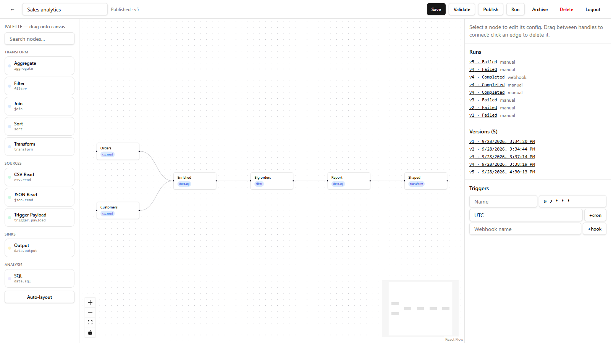
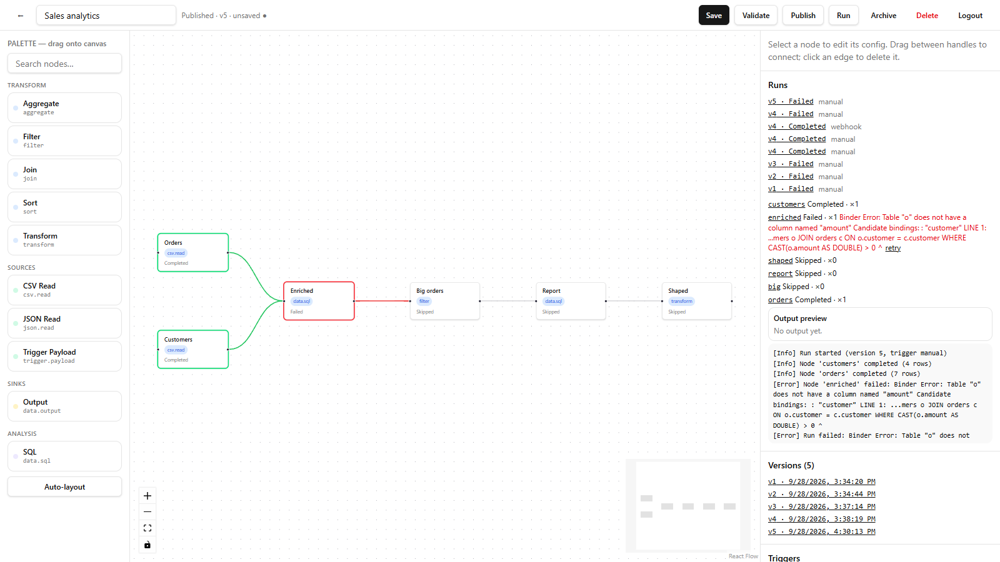

# Reflow

**Visual data pipeline orchestration: design a DAG of nodes on a canvas, publish an immutable version, and run it on a schedule, a webhook, or on demand — with retries, logs, and full run inspection.**

[](https://github.com/jasserhouimli/Reflow/actions/workflows/ci.yml)


## What it is

Reflow is a platform for building and running data pipelines visually. Nodes are
dragged onto a canvas and connected into a DAG, the graph is validated and
published as an immutable version, and runs are started manually, on a cron
schedule, or by an inbound webhook. Each run executes with dependency-aware
scheduling, bounded retries, cancellation, and recovery of interrupted work.

The control plane — pipelines, versions, runs, tasks, and triggers — lives in
PostgreSQL. The data plane performs analytical work through a DuckDB engine, with
readers for CSV and JSON and SQL-based node handlers.

Reflow is a modular monolith: each module owns its data and its EF Core schema, and
cross-module calls go through explicit contracts rather than direct table access.

## Preview

### Visual canvas — drag nodes, connect handles, guided configuration



### Live runs — per-node status, output preview, logs, and versions



## Highlights

- Visual DAG editor (React Flow) with a palette driven by `GET /api/node-types`.
- Immutable, versioned publishing — a run always executes a frozen pipeline version.
- Three trigger types: manual, cron schedule (timezone and overlap policy), and idempotent webhooks.
- Dependency-aware execution with atomic task claims, bounded retries, cancellation, and crash recovery.
- Live run updates pushed to the editor over SignalR.
- A registry of independent node types — the engine resolves handlers by type id and contains no type switches.
- Analytical execution on DuckDB, with CSV/JSON readers and downloadable run artifacts.

## How it works

```text
Canvas (React Flow, palette from GET /api/node-types)
        ↓  save / validate / publish (immutable version)
Trigger (manual / cron / webhook, idempotent)
        ↓
Pipeline run → DAG execution engine (wake-up pulses, atomic claims, bounded retries)
        ↓  live runChanged pushes over SignalR
Node handlers → DuckDB SQL (filter / transform / aggregate / join / sort)
        ↓
Task outputs, attempts, logs, artifacts, lineage-ready metadata
```

Triggers start runs; they never execute pipelines inline. Webhook events are
persisted and deduplicated on `(trigger, external event id)`. Tables referenced by
`data.sql` are named after their source nodes (`FROM orders o JOIN customers c`).

## Node types

| Type | What it does |
|------|--------------|
| `csv.read` | Parse CSV text into a table |
| `json.read` | Parse JSON text or unpack an upstream JSON column |
| `trigger.payload` | Parse the run's webhook or schedule payload |
| `filter` | `WHERE` predicate compiled to SQL (8 operators) |
| `transform` | `SELECT` / `EXCLUDE` / `RENAME` compiled to SQL |
| `aggregate` | `GROUP BY` with count / distinct / sum / avg / min / max |
| `sort` | Multi-key `ORDER BY` |
| `join` | Inner or left join on shared or distinct keys |
| `data.sql` | Free-form DuckDB SQL over node-named tables |
| `data.output` | Save a downloadable JSON or CSV run artifact |

See the usage guide for trigger configuration and day-to-day workflows.

## Tech stack

- **Backend:** .NET 10, ASP.NET Core Minimal APIs, vertical slices
- **Data:** DuckDB (analytical SQL); PostgreSQL + EF Core (control plane)
- **Auth:** JWT over HttpOnly cookies
- **Real-time:** SignalR
- **Frontend:** React 19, TypeScript, Vite, Tailwind, React Flow
- **Tooling:** Serilog, FluentValidation, Cronos, Swagger (dev)
- **Tests:** xUnit — 85 unit and 25 API integration tests

## Architecture

- Modular monolith; each module owns its data and EF Core schema.
- Cross-module calls only through explicit contracts (`IPipelineSnapshotProvider`, `IPipelineAccessChecker`, `IPipelineRunStarter`, `IRunMonitor`) — never direct table access.
- Node types are independent slices (type id, editor definition, config validation, SQL-compiling execution, registration, tests), resolved through a registry.

| Module | Responsibility | Status |
|--------|---------------|--------|
| Identity | Register, login, logout, JWT refresh, `/api/v1/auth/*` | Done |
| Pipelines | CRUD, DAG validation, immutable versions, publish/archive | Done |
| NodeTypes | Registry, `GET /api/node-types`, 10 slices (sources, shaping, SQL, sinks) | Growing |
| DataProcessing | In-memory tabular frames, CSV/JSON codecs, DuckDB analytical engine, run artifacts | Done |
| PipelineExecution | Runs, attempts, logs, worker, retries, cancel, recovery | Done |
| Triggers | Cron schedules, idempotent webhooks, scheduler worker | Done |

## Quick start

Prerequisites: .NET 10 SDK, PostgreSQL 16+, and Node 22+.

```bash
# Apply each control-plane schema
dotnet ef database update --context IdentityDbContext          --project src/Reflow.Api
dotnet ef database update --context PipelinesDbContext         --project src/Reflow.Api
dotnet ef database update --context PipelineExecutionDbContext --project src/Reflow.Api
dotnet ef database update --context TriggersDbContext          --project src/Reflow.Api

# Run the API, then the editor
dotnet run --project src/Reflow.Api --urls http://localhost:5001
cd frontend && npm install && npm run dev   # http://localhost:5173
```

## Documentation

- [Usage guide](docs/usage.md) — running Reflow, trigger configuration, and testing.
- [API reference](docs/api.md) — the pipeline, run, task, and node-type endpoints.

## Roadmap

- Architecture boundary tests in CI.
- Arrow interchange and Parquet artifacts.
- Connections (database sinks by reference, not credentials).
- Docker Compose.
- Dataset catalog persistence and lineage UI.
